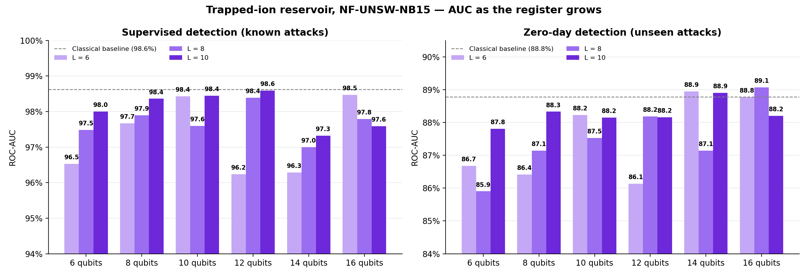

# iontraps-qrc

Quantum reservoir computing on a trapped-ion (all-to-all coupled) register for network-intrusion and
**zero-day** detection on NF-UNSW-NB15. The study asks whether more qubits or more time steps (L) help a
simulated ion-trap reservoir against a classical PCA baseline.



## Headline results (18-cell grid, 6–16 qubits x L = 6, 8, 10)

- Supervised AUC: quantum 0.962–0.986 vs classical 0.984–0.986. Every difference is ≤ 0, the best cell
  (12q, L=10) ties at −0.001.
- Zero-day AUC: quantum 0.859–0.891 vs classical 0.888. Cells at 14–16 qubits reach parity
  (+0.002, +0.001, +0.003, 0.000), but no interval excludes zero on the positive side.
- Trend is **not monotone** in qubits; larger L helps at small N. See `results/README.md` and
  `notebooks/scaling_with_qubits.ipynb` (also gap-with-95%-interval and live-feature plots).

## Layout

```
src/iontraps_qrc/   core.py (reservoir, simulators, readout, detector), sweep.py (grid), parallel.py, report.py
scripts/            run_sweep.py (CLI), rerun_all.sh (full grid)
notebooks/          scaling_with_qubits.ipynb  -> figures/
results/            committed results (see results/README.md)
data/               see data/README.md
tests/              smoke tests
```

## Setup

```bash
pip install -e .            # numpy, pandas, pyarrow, scikit-learn, scipy, matplotlib
pip install -e ".[notebooks,dev]"
# optional, only for backend "nexus"/"syntax": pip install -e ".[hardware]"
```

## Run

```bash
python scripts/run_sweep.py --dry-run                              # circuit budgets only
python scripts/run_sweep.py --quick --only 6q_a2a_L6               # wiring check (numbers not meaningful)
python scripts/run_sweep.py --data data/raw/NF-UNSW-NB15-v2.parquet --qubits 6,8 --L 6,8,10
python scripts/run_sweep.py --qubits 16 --L 6 --workers 24         # parallel, bit-identical to serial
pytest                                                              # smoke tests
```

## Notes

- Results in `results/` were produced on the v2 parquet, which is not included (`data/README.md`).
  The default `data/raw/NF-UNSW-NB15.parquet` (v1) runs end to end but will not reproduce them.
- Changes vs the original scripts: renamed into a package, imports/paths made relative to the repo,
  one CLI (`run_sweep.py`) replacing the two v2 wrappers. Reservoir/readout logic is untouched.
- Simulation only (NumPy statevector with sampled shots); no hardware results.
